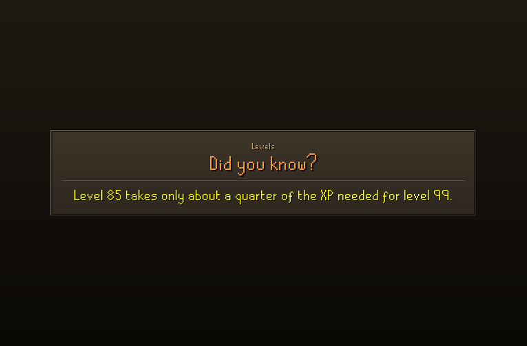

# POH Loading Tips

A RuneLite plugin that replaces the broken-down house picture you see while your player-owned house loads. Instead, you get a quick OSRS tip or a "Did you know?" fact, shown in the game's own font and colours.

## Features
- Covers the house loading screen with an OSRS-style stone panel: an orange title and yellow text with a black shadow.
- Includes 148 tips and facts checked against the [OSRS Wiki](https://oldschool.runescape.wiki). Tips are dealt like a shuffled deck, so you won't see a repeat until you've seen them all.
- The loading screen is only up for a second or two, so after it closes the tip stays on a small banner at the top of the screen for a few seconds and then fades out. You can change how long it stays.
- Text shrinks automatically to fit both fixed and resizable mode.

## Settings
| Setting | Default | What it does |
|---|---|---|
| Show quick tips | On | Useful gameplay tips |
| Show 'Did you know?' facts | On | Trivia and history |
| Text size | 24 | 16 is the normal in-game size |
| Keep tip after loading | 4s | Banner after loading (0 = off) |
| Also post tip in chat | Off | Posts the tip as a game message |

## Adding tips
Edit `src/main/resources/com/pohloadingtips/tips.txt`. Put one tip on each line, in the form `TIP|Category|Text` or `FACT|Category|Text`.

## Credits
Tips and facts are written from information on the [Old School RuneScape Wiki](https://oldschool.runescape.wiki).

## Running
You need JDK 11 or newer. Run `./gradlew run` (or `gradlew.bat run` on Windows) to launch RuneLite in developer mode with the plugin loaded.
